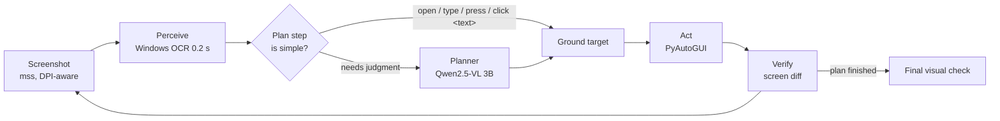

# Omni-Agent

A computer-use agent that operates Windows **the way a person does: by looking at the screen and using the
mouse and keyboard**. It never reads HTML, accessibility trees or app APIs to decide what to do, so the same
loop works on desktop apps, websites, legacy software and canvas apps.

It runs **entirely free and offline on a laptop GPU** (GTX 1650, 4 GB VRAM) using a 3B vision-language model
through Ollama, with Google's free Gemini tier as an optional stronger planner.

```text
> omni-agent run "Switch Calculator to Scientific mode" --allow Calculator
Plan (4.3s): open Calculator -> click Mode -> click Scientific
1. [open Calculator] launch Calculator (skill)
   -> launched 'Calculator' from Start
2. [click Mode] click Mode (skill)
   -> clicked 'Mode'
3. [click Scientific] click Scientific (skill)
   -> clicked 'Scientific'
4. final check -> True - The calculator is in Scientific mode, as indicated by
the 'Scientific' label on the screen.
```

"Mode" is not written anywhere in Calculator, so step 2 fell through to the vision model, which found the
unlabeled ☰ menu (point + zoom, 42 s). "Scientific" is visible text, so step 3 was matched by OCR in 0 s.

Every run writes an HTML report: one card per step, with the screenshot, the numbered elements the agent
saw, a red marker where it clicked, its reasoning, and timings.

## How it works



1. **Decompose once.** The model turns the goal into short steps (`open Notepad`, `type "hi"`,
   `press ctrl+s`, `click Save`). This is a text-only call (~5 s), which small models do well.
2. **Run simple steps directly.** Open / type / press / wait / scroll steps, and clicks on named text, run
   as deterministic skills with **no model call**. The model is consulted only for steps that need judgment.
3. **Perceive with pixels only.** Windows' built-in OCR engine reads the screen in ~0.2 s and every text
   group becomes a numbered element. The planner reasons over this list, and is shown the screenshot only
   when text is not enough (few elements, the last action had no effect, or a target was not found).
4. **Ground in three tiers, cheapest first:**
   | Tier | How | Cost |
   |---|---|---|
   | text | target names visible text: click that OCR box | 0 s, no model |
   | mark | planner picked a numbered element: click its centre | 0 s |
   | point + zoom | model guesses coordinates, then sees a 2x crop around the guess and refines | ~40 s |
5. **Verify.** After each action the screen is diffed; "no visible change" is fed back to the planner. When
   the plan is finished, one screenshot check confirms the goal before reporting success.

## Measured on a GTX 1650 (4 GB) / 8 GB RAM laptop

| Measurement | Result |
|---|---|
| Screen reading, Windows OCR vs RapidOCR (CPU), 1080p | **0.1-0.2 s** vs 7 s |
| Model turn with a screenshot (Qwen2.5-VL 3B, Ollama) | ~20 s |
| Model turn, text only | ~5 s |
| Raw coordinate pointing, 3B model, 10 OCR'd text targets on a live screen | 30% within the box |

Live tasks (all completed, verified from the run screenshots):

| Task | Steps | Model calls | Time |
|---|---|---|---|
| Open Notepad and type a sentence | 6 | 2 (plan + final check) | 44 s |
| Compute 125 x 8 in Calculator | 4 | 2 | 41 s |
| Switch Calculator to Scientific mode | 4 | 4 (needed vision to find the ☰ menu) | 80 s |

**What these numbers taught the design.** A 3B model points at small UI text poorly (30%), and every image it
sees costs ~20 s because Ollama upscales screenshots to at least ~1,000 tokens. So the agent is built to
*avoid asking the model*: OCR text matching does most grounding for free, simple steps skip the model, and
the screenshot is attached only when needed. Forcing all model layers onto the 4 GB GPU was 2.5x *slower*
than Ollama's automatic CPU/GPU split, because Windows spills the overflow into shared memory.

## Safety

The agent drives your real mouse and keyboard, so it is fenced in:

- **Kill switch:** `Ctrl+Alt+Q`, or slam the mouse into any screen corner.
- **Allow-list:** `--allow Notepad` lets it click and type only while that window is active.
- **Risky actions** (delete, send, pay, shut down, shift+delete...) ask for confirmation first.
- **Never types into your existing files.** Editors like Windows 11 Notepad reopen previous files, so after
  opening an editor the agent starts a fresh document, and it refuses to type into a window whose title
  names a saved file the goal does not mention. (Added after an early test typed into a reopened file.)
- **Dry run:** `--dry-run` plans and locates targets without touching input.
- Run logs contain screenshots of your desktop and are git-ignored. With the default local model nothing
  leaves your machine; the optional Gemini backend sends screenshots to Google.

## Quick start

Requirements: Windows 10/11, Python 3.11-3.13, [Ollama](https://ollama.com).

```bash
ollama pull qwen2.5vl:3b
python -m venv .venv && .venv\Scripts\activate
pip install -e ".[dev]"

omni-agent see                      # print and save what the agent perceives on screen right now
omni-agent run "Use Calculator to compute 125 times 8" --allow Calculator --open
```

Useful flags: `--vision auto|always|never`, `--max-steps N`, `--monitor N`, `--dry-run`, `--no-confirm`.
To use Gemini's free tier as the planner: set `GEMINI_API_KEY` and pass `--backend gemini`.

## Project layout

```text
omni_agent/
  agent.py        perceive -> plan -> ground -> act -> verify loop
  planner.py      goal decomposition, next-action prompting, final check
  skills.py       plan steps that run without the model; editor safety rules
  grounding.py    text match, numbered marks, point + zoom refinement
  perception/     Windows OCR / RapidOCR, element model, numbered-box annotation
  actions.py      action schema, robust JSON parsing, executor (PyAutoGUI / pydirectinput)
  safety.py       kill switch, allow-list, confirmations
  recorder.py     per-run screenshots + HTML report
bench/            speed and accuracy experiments
tests/            52 tests; the full loop runs against a scripted model and synthetic screens
```

## Roadmap

- [x] Core loop, OCR perception, three-tier grounding, safety controls, HTML run reports
- [x] Hierarchical planning with direct skills and adaptive vision
- [ ] Icon detector (OmniParser) so unlabeled icons get numbered boxes instead of needing point + zoom
- [ ] ScreenSpot benchmark for grounding accuracy, and a 20-task suite across Windows apps
- [ ] Trajectory replay: re-run successful tasks from recorded steps, falling back to the model on change
- [ ] LoRA fine-tune of the grounder on its own successful runs (free Kaggle / Colab GPU)

## License

MIT
